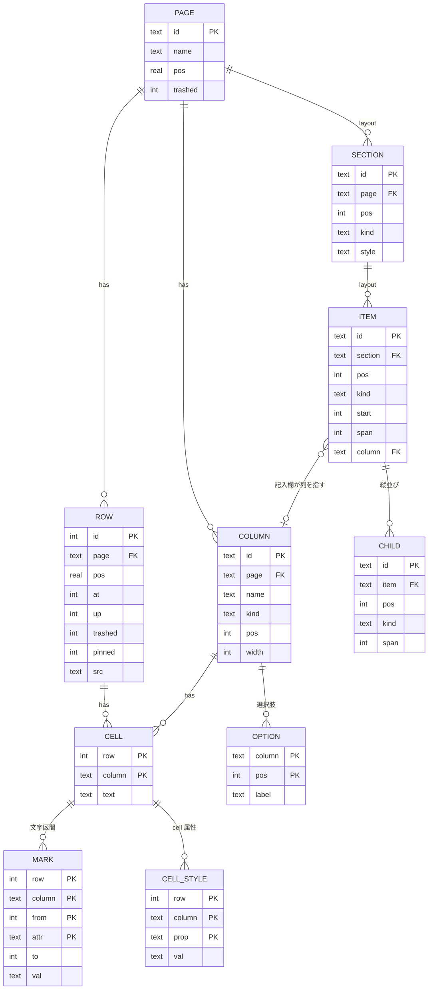
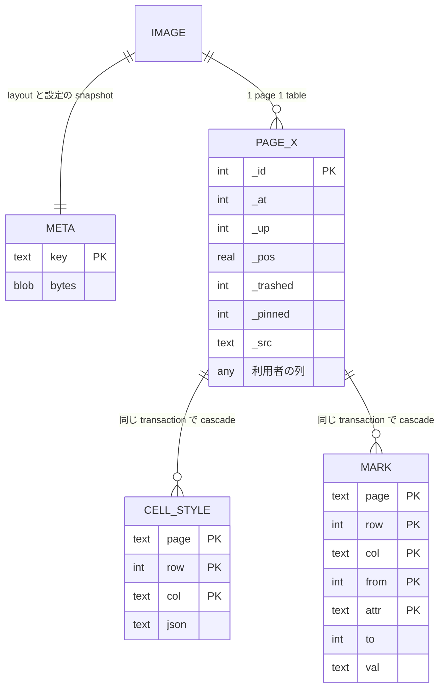

# table 設計

出発点は数学的に正しい正規形であり、到達点はそこから「実際に投げる SQL が最も素直に書ける所」まで崩した形である。崩す理由は常にコスト (frame 数、page 数、object byte) で言える。

## 1. 出発点: 正規化し切った形

どの table も鍵以外の属性が鍵の全体にだけ関数従属し (BCNF)、多値従属は OPTION と MARK と CELL_STYLE を分けたことで消え (4NF)、結合従属は自明なものしか残らない (5NF)。CELL は (row, column) → text、MARK は (row, column, from, attr) → (to, val)、CELL_STYLE は (row, column, prop) → val であり、重複する事実は 1 つも無い。

## 2. 実際に投げる SQL

| 使い方 | 正規形での形 | 崩した形での形 | 頻度と cost |
| --- | --- | --- | --- |
| 窓を読む (w 行) | CELL を row で絞り column で pivot (列数ぶんの CASE か self join) | `SELECT * FROM page_x WHERE _id BETWEEN ? AND ?` | 最頻。leaf ceil(w ÷ f) 枚 |
| cell を確定する | `INSERT OR REPLACE INTO cell` 1 行 | `UPDATE page_x SET "列" = ? WHERE _id = ?` | 最頻。1 frame |
| 行を足す | ROW 1 行 + CELL 列数ぶん | `INSERT INTO page_x` 1 行 | 1 から 2 frame |
| 行を消す | ROW と CELL と MARK と CELL_STYLE を 4 文 | `DELETE FROM page_x` と装飾 2 table の `DELETE … WHERE row = ?` を同じ transaction | 1 から 3 frame |
| 列を足す | COLUMN 1 行 | `ALTER TABLE page_x ADD COLUMN` | 1 frame |
| 列名を変える | COLUMN 1 行 | `RENAME COLUMN` と装飾 2 table の `UPDATE … SET col = ? WHERE col = ?` | 1 frame + 装飾件数 ÷ f |
| 列を消す | COLUMN 1 行 + CELL の該当 column 全削除 | layout から外すだけにし、物理 DROP は snapshot 生成時に相乗り | 0 frame (遅延) |
| 並べ替えて窓を読む | pivot した上で ORDER BY | `ORDER BY "列" IS NULL, "列" LIMIT ? OFFSET ?` | 全走査 O(N)。index を作らない |
| 絞り込み / group / 検索 | pivot した上で WHERE / GROUP BY / LIKE | `WHERE "列" = ?` / `GROUP BY "列"` / `LIKE` | 全走査 O(N) |
| CSV を取り込む | ROW と CELL を行 × 列 件 | `INSERT` 行数件を 1 transaction | O(N)、file 全 page |
| 集計を表に描く | pivot + 集計 | `SELECT "x", SUM("y") … GROUP BY "x"` | 全走査 O(N) |
| 公開 form からの 1 行 | ROW + CELL | `INSERT INTO page_x (…, _src) VALUES (…, 'form')` | 1 から 2 frame |
| 窓の装飾を読む | MARK と CELL_STYLE を row の範囲で | `WHERE page = ? AND row BETWEEN ? AND ?` を 2 文 | WITHOUT ROWID の範囲走査、0 から 1 page |
| LLM の自由 SQL | pivot を LLM が書く | 列名がそのまま列なので 1 文 | 全走査 O(N)、返答は LIMIT で窓以下 |

正規形の痛みは 1 点に集中する。窓・並べ替え・集計・LLM の SQL が全て pivot を要し、SQL が列数に比例して長くなり、1 cell 1 行の table は typed 横持ちの 1.2 から 2.8 倍の page を占める。他方で正規形が得意な「列の追加と削除が DML で済む」利点は、ADD COLUMN が 1 frame であることと DROP を snapshot に遅らせることで横持ちでも手に入る。

## 3. 到達点: 崩した形

PAGE、COLUMN、OPTION、SECTION、ITEM、CHILD は sqlite の table にならず、yjs の layout として 1 つの snapshot blob (META) に入る。理由は、これらを読む SQL が「page ごとに全部」しか無く列の値をまたぐ結合が存在しないこと、key value store と同じ読み方しかしないものに table を与えても page を増やすだけであること、そして行数 N に依存しないので snapshot 1 枚が常に小さいことである。CELL は PAGE_X の列へ畳み込まれ、列名は利用者が付けた名前そのもの (日本語可、同名は `名前 (2)`) になる。OPTION は列の layout に選択肢の配列として入り、値は選択肢の文字列をそのまま TEXT で持つ (複数選択は区切り文字で結合)。辞書 table と整数 flag にしない理由は、1 列の値が 2 table にまたがる二重管理を避けることと、group by と LIKE が TEXT のままで同じ速さで効くことである。

物理 schema (sqlite_master) と layout (META) は 2 つの正になるので、「layout の記入欄が指す列は必ず物理に存在する」を judge が確認する。物理にあって layout に無い列は、遅延 DROP 待ちの列として許す。

## 4. system 列

`_id` は rowid そのもので、tree の key と装飾の row に使う。`_at` と `_up` は作成と更新の時刻で、作成日時と更新日時の記入欄は列を持たずこれを読む。`_pos` は利用者が手で並べ替えたときだけ使う実数で、既定の表示順は rowid 順である。既定が rowid 順であるために窓の読みが `BETWEEN` の範囲走査になり、並べ替えを選んだときだけ O(N) になる。`_trashed` と `_pinned` は 2 段階削除と固定、`_src` は編集画面か公開 form かの出所である。

利用者の列は NULL を許し、NULL を空とみなす。NULL は 0 byte、空文字列は 1 byte で、並べ替えは `IS NULL` を先に置いて空を末尾に送る。

## 5. 装飾

MARK は文字区間 (from, to) に付き、本文の確定と同じ transaction で該当 cell の MARK を delete してから insert し直す。本文が先頭に 1 文字増えても MARK は自動で動かないので、位置の正は常に editor の確定時の再書き込みである。CELL_STYLE は (page, row, col) に付き、本文が空になっても残り、行が並べ替えで動いても row id に付いているので一緒に動く。行の削除と列の削除で該当行を同じ transaction で消すことで孤児を 0 に保ち、table 名が page ごとに変わるため外部 key の cascade は使わず adapter の transaction で行う。孤児は `row NOT IN (SELECT _id FROM page_x)` または `col` が物理列に無いものを数えて検出する。

どちらの table も WITHOUT ROWID で鍵順に並ぶので、窓の読みは (page, row) の範囲走査で済み、列削除の cascade は col 一致の delete で件数 ÷ f の frame になる。

## 6. 宣言から DDL への写像

page の既定の列は宣言 1 つで layout の記入欄と DDL と既定値を同時に決める。宣言は型と既定値と optional を持つ schema (zod) で書き、JSON Schema へ落とせる範囲 (default、description、enum、integer、format date / date-time、任意の meta) だけを使う。

| 宣言 | 列の型 | 値の形 | 方眼紙での種類 |
| --- | --- | --- | --- |
| string | TEXT | 本文 | 文字列 / ラジオ / ドロップダウン / リンク / ルックアップ |
| enum | TEXT | 選択肢の文字列 | ラジオ / ドロップダウン (選択肢は layout) |
| number | REAL | 数値 | 数値 / 金額 / パーセント |
| number.int | INTEGER | 整数 | 件数 |
| boolean | INTEGER | 0 / 1 (0 byte) | チェックボックス |
| string date / datetime | TEXT | ISO 8601 の 1 書式 | 日付 / 日時 / 時刻 |
| array / object | TEXT | 区切り結合または JSON | 複数選択 / テーブル |
| default(v) | DEFAULT v | | |
| optional 無し | NOT NULL | | |

利用者が後から足す列も同じ写像で runtime に DDL になる。宣言の無い page は system 列だけの table になる。

## 7. 変更の階級と方針

| 変更 | 物理操作 | frame | 方針 |
| --- | --- | --- | --- |
| 列の追加 | ADD COLUMN | 1 | 操作のたびに即時 |
| 列名の変更 | RENAME COLUMN + 装飾の col 更新 | 1 + 装飾件数 ÷ f | 即時、同じ transaction |
| 列の削除 | layout から外す → snapshot 時に DROP COLUMN | 0 → snapshot に相乗り | 遅延 |
| 種類の変更 | 物理型は変えず layout の kind だけ変える | 0 | 数値の並べ替えは CAST で行う |
| 型の変更 | table 再作成 | file の 2 倍 | 行わない |

列幅と並び順と選択肢は layout だけの変更であり、frame を生まない。
