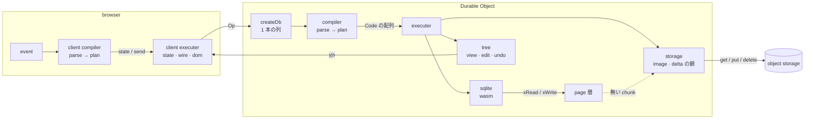

# sqlite

1 つの file は 1 つの SQLite database で、Durable Object が唯一の writer である。database の page は object storage に「image 1 つ + delta の鎖」として置かれ、SQL が必要とした部分だけが memory に来る。書き込みは logical な命令を compiler が physical な命令の列に変え、executer が上から実行する。

## 1. 用語

| 言葉      | 意味                                                                                 | DBMS の言葉での位置づけ              |
| --------- | ------------------------------------------------------------------------------------ | ------------------------------------ |
| page      | SQLite の 4096 byte の固定長 block                                                   | pager が扱う単位                     |
| page 層   | VFS として SQLite に file を見せる層。chunk の cache、保存前の page、汚れた page 番号 | buffer pool + dirty page table       |
| chunk     | 連続する 512 page。image の圧縮と range GET の単位                                   | extent                               |
| image     | 全 page を chunk ごとに gzip して並べた object (番号 0)                              | checkpoint 済みの database file      |
| delta     | 1 回の save で書き換わった page の集合 (番号 1 〜)                                   | redo log の 1 segment (page image)   |
| 鎖        | delta が 1 つ前の object の etag を持つことで決まる順序                              | log sequence の連続性                |
| merge     | image と全 delta と汚れた page を 1 つの image に書き直すこと                        | checkpoint                           |
| view      | 登録された問い合わせと、その結果を yjs に載せたもの                                  | materialized view                    |
| logical な命令 | 利用者と LLM がしたいこと (`cell`、`row.add`、`window`、`save` …)               | SQL 文に当たる                       |
| physical な命令 | 装置 1 つへの操作 (`sql`、`view`、`push`、`merge` …)                           | bytecode に当たる                    |

## 2. 構成

| package                          | 種類        | 中身                                                         |
| -------------------------------- | ----------- | ------------------------------------------------------------ |
| `@db/server`                     | declarative | compiler と executer を 1 本の列で繋ぐ                       |
| `@db/server-compiler-parse`      | declarative | 命令ごとの field と検査の表                                  |
| `@db/server-compiler-plan-*`     | declarative | 命令ごとの SQL と physical な命令の並び (sync / table / row / view) |
| `@db/server-executer`            | declarative | physical な命令 14 種と装置の対応表                          |
| `@db/server-executer-sqlite`     | declarative | wasm の接続、文の実行、読み取り専用の実行、rollback          |
| `@db/server-executer-page`       | declarative | VFS、chunk の cache、保存前の page                           |
| `@db/server-executer-store`      | declarative | image と delta の読み書き、鎖、compare-and-swap              |
| `@db/server-executer-tree`       | declarative | view の登録と反映、編集 key、undo                            |
| `*-share` `*-check` `*-codec` `*-csv` `*-name` `*-cursor` `*-event` | procedural | 状態を持たない関数 |

親は子の package を import でき、子は祖先の `share` だけを import できる。兄弟は import し合わない。境界は各 `package.json` の `dependencies` で、vite の plugin がそれ以外の import を拒む。

## 3. 不変条件

### 3.1. store の内容は、常に commit 済みの transaction の境目である

命令の列は 1 本の列に並んで走り、失敗した列は rollback されるので、列の切れ目で page 層にあるのは commit 済みの page だけである。save はその切れ目でしか走らない。1 回の save は 1 回の put で、put は object 単位で全部か無かである。途中で落ちても、store には「前の save」か「今の save」のどちらかがある。

### 3.2. put は必ず compare-and-swap である

image は「前に読んだ etag と同じなら」、delta は「まだ無ければ」で書く。条件が外れたら書かずに止まる。writer が 2 つになっても、後から書いた側が止まり、store は壊れない。

### 3.3. delta は鎖に繋がっているときだけ有効である

delta n は object n − 1 の etag を持つ。image を書き直すと etag が変わるので、古い delta は消し損ねても適用されない。open は鎖の切れ目で読むのを止め、切れた先を消す。

### 3.4. delta があるのは image が 2 chunk 以上のときだけである

1 chunk に収まる image は毎回 image ごと書く。このとき open は GET 1 回、save は PUT 1 回で、delta を探す GET も要らない。database の page 数は VACUUM しない限り減らないので、2 chunk 以上になった image が 1 chunk に戻ることは無い。

### 3.5. 変化が無ければ store を呼ばない

save の命令列は `stat` だけから決まり、汚れた page が 0 なら空になる。push か merge かも同じ式で決まる (cost.md 4 節)。

### 3.6. SQL だけが正で、tree は写しである

行と装飾を持つのは SQLite だけである。tree の view は、書き込みのたびに登録済みの問い合わせを実行し直して作る。tree を先に書いて後から SQL に流す経路は、undo の 1 本だけで、それも compiler を通る。

### 3.7. 装飾は位置に付き、位置と一緒に消える

行、列、page の削除と列名の変更は、装飾の delete / update と同じ transaction に並ぶ。装飾の insert は、その行とその列が在るときだけ行が入る文になっている。

### 3.8. compiler は純関数で、executer は意味を知らない

compiler は `(op, stat)` から命令列を返すだけで、何も読まず何も書かない。executer は命令を上から実行し、cell や列名の意味を知らない。命令列の途中で失敗したら、開いている transaction を rollback する。

### 3.9. 利用者の文字列は SQL の文に入らない

値は必ず bind する。名前は drizzle が識別子として囲み、その前に parse が `_` 始まり、`sqlite_` 始まり、`rowid`、制御文字を拒む。自由な SQL は authorizer が読み取り以外を拒む状態でしか実行しない。

## 4. 壊れ方から見る場所

| 見えたこと                                        | 最初に見る場所                                                                          |
| ------------------------------------------------- | --------------------------------------------------------------------------------------- |
| open し直すと変更が消えている                     | save が reject していないか。`store diverged` / `store conflict` は 3.2 が働いた結果    |
| open が `image corrupt` / `delta corrupt` で止まる | object の先頭 4 byte (`SQLI` / `SQLD`)、gzip の伸長、delta の長さの式                    |
| SQL が終わらない                                  | page 層の非同期の読みが reject していないか (errata.md 1 節の `handleAsync`)            |
| wasm が `unreachable` で落ちる                    | page 層の `xRead` が、再入のときも `handleAsync` を通っているか (errata.md 1 節の Asyncify) |
| `database disk image is malformed`                | image の chunk の並びと page 数、delta の適用順、`_kept` (base のうちまだ有効な page 数) |
| GET が多い                                        | delta の数 (`stat().deltas`)、chunk の cache が溢れていないか、全走査の SQL             |
| PUT が多い                                        | save を呼ぶ間隔。1 回の save が 2 回 put することは無い                                 |
| 孤児がある                                        | 削除の命令列に装飾の delete が並んでいるか、装飾の insert の `where exists`             |
| undo で値が戻らない                               | `fill` が `set` より前にあるか、他の client が後から同じ cell を書いていないか          |
| undo の値が別の行に書かれる                       | page table の `_id` が `AUTOINCREMENT` か (tables.md 4 節)                              |
| `sql` の結果に別の文の行が混ざる                  | sqlite の実行が文ごとに行の配列を作り直しているか (errata.md 1 節の `statements`)       |
| view が古い                                       | 書き込みの命令列の最後に `refresh` があるか、view が登録されているか (`window`)         |

## 5. 参照表

| 知りたいこと                                   | file                     |
| ---------------------------------------------- | ------------------------ |
| 検証 code が触れてよい面、object の形、命令の表 | `references/contract.md` |
| 費用の式と、そこから出た定数                   | `references/cost.md`     |
| table の正規形と崩し方                         | `references/tables.md`   |
| 方眼紙、窓、装飾の付き先、undo                 | `references/grid.md`     |
| 外部の事実と確かめ方                           | `references/errata.md`   |
| 検証に使うデータ                               | `references/fixtures.md` |
| simulation の境界、軸、台帳                    | `references/score.md`    |

## 6. 完了と言える条件

台帳の最新の 1 件が今の `src/` に対するもので、崩れた判定が 0 件であるか、崩れた判定の全てに原因と再現手順が付いていること。点数だけの報告は進捗である。
