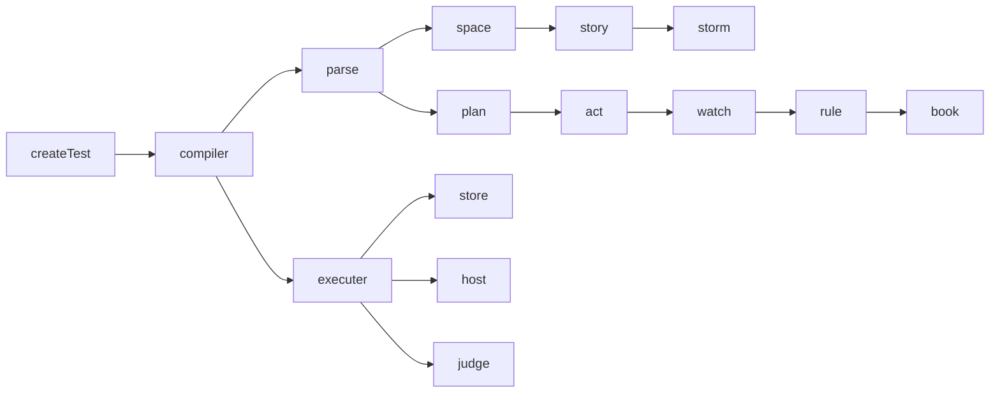

# 検証と採点

検証は deterministic simulation (DST) で行う。目的は、製品をさまざまな state と順序で動かし、安全性と生存性がどの region で成り立たないかを見ることである。点数は目的ではない。

## 1. 2 つの性質

| 性質   | 意味                                                                                                         | 判定する axis                                                         | 失敗したとき                               |
| ------ | ------------------------------------------------------------------------------------------------------------ | --------------------------------------------------------------------- | ------------------------------------------ |
| 安全性 | store の image と chain の delta は、どの時点でも 1 つの SQLite database を表し、成功した save の内容を失わない | integrity、永続、原子、chain、writer、上限、compile、装飾、window、履歴、一致 | 不具合である。再現できる scenario を残す   |
| 生存性 | 障害が無ければ open と save は resolve し、store の呼び出し回数と転送量は cost.md の式どおりで、丸ごと保存 (cost.md 9 節) より少ない | 可用、回数、式、丸ごと保存、最良 | 可用と回数は不具合である。費用は計測値として region ごとの比を残す |

node は 1 つで、合意する相手は居ない。この製品で replica に当たるのは store の object (image と delta) で、合意に当たる性質は「image に chain の delta を重ねたものが 1 つの database である」ことである。費用が丸ごと保存を下回ることを確かめるまで、この方式は製品に組み込まない。

## 2. simulation

```mermaid
flowchart LR
    SEED[seed と指定] -->|explore| STEPS[step の配列]
    HAND[手書きの scenario] --> STEPS
    STEPS -->|1 step| C[compiler<br>parse → plan]
    C -->|physical な命令| X[executer<br>store · host · judge]
    X -->|facts| C
    X <-->|send / serve<br>data だけ| SIM[.bench/sim.ts]
    SIM --> DB[(@db/server<br>@db/client)]
```

| 規則   | 内容                                                                                                                                                                                         |
| ------ | -------------------------------------------------------------------------------------------------------------------------------------------------------------------------------------------- |
| 決定論 | 同じ指定は、同じ scenario、同じ観測、同じ判定を再現する。乱数は seed から計算した値だけを使い、実時刻と `Math.random` は使わない                                                             |
| 形式   | seed が生成する scenario と手書きの scenario は同じ形式で、同じ経路で実行される (space.md 6 節)                                                                                              |
| 結合   | `@db/test` は `@db/server` と `@db/client` を import せず、製品の object も引数に受け取らない。製品の API を呼ぶのは `.bench/sim.ts` だけで、`@db/test` とは `send` (検証 → 製品) と `serve` (製品 → 模擬 store) の 2 つの関数で data だけをやり取りする |
| API    | 検証 code が使ってよい製品の API は contract.md だけである。API に無い振る舞いは測らない                                                                                                     |
| 重複   | 製品にある機能を検証 code に書かない。image と delta の decode、`Op` の検査、save の式、SQL の意味は、製品の API (`run` / `compile` / `execute` / `stat`) を呼んで得る。定数は `@db/server` の export を `sim.ts` が渡す |
| 期待値 | 手書きの値か、同じ製品を別の instance で観測した値である。shadow (node と同じ `Op` を受け取る instance) と probe (store の copy を開く instance) を使い、製品の意味を写した model を持たない  |
| time   | time は simulation 内の値で、`t.tick` だけが進める。`@db/server` と `@db/client` は時刻も乱数も読まない (space.md 4 節)                                                                     |

## 3. 状態空間

seed が決める値の境界、region、長期利用後の state の作り方は space.md 2 節と 3 節にある。region の区分は実行前に決めてあり、ledger は同じ名前で到達回数を数える。到達が 0 回の region は未計測である。

## 4. 外から起きること

利用 (`use`) と出来事 (`event`) の種類、time の規則、同時実行が起きる条件は space.md 4 節と 5 節にある。object の破損、欠落、古い内容の返却は範囲外で、破損からの復旧は作らない。

## 5. 判定

step ごとに自動で行う判定である (space.md 7 節)。shadow を使う判定は、node と shadow の結果が一致している間だけ行う。

安全性の axis。1 回でも失敗したら不具合である。

| axis      | 成り立つべき性質                                                                                                                                                                 |
| --------- | -------------------------------------------------------------------------------------------------------------------------------------------------------------------------------- |
| integrity | store に書き込んだ save の後、および open の後に、store の copy を別の instance で開くと `open` が resolve し、`pragma integrity_check` が `ok` を返す                           |
| 永続      | save が store に書き込んだ後、store の copy を開いた probe の全 table の内容が、save の時点の shadow の内容と一致する。store を呼ばなかった save の時点の内容は、保存済みの内容と一致する |
| 原子      | node を失って open し直した内容は、「最後に成功した save」か「実行途中だった save」のどちらかの時点の内容と一致する                                                              |
| chain     | 障害が無い save と open の後、store の object は image 1 つと chain に繋がる delta だけである。chain の外の delta は内容に現れない                                               |
| writer    | 他の node の save を知らない node の save は、store に書き込まずに reject する                                                                                                   |
| 上限      | `LIMIT` を超える 1 回の import は reject し、内容は直前のままである。2 chunk 以上の database で、save の後の `patch + dirty` は `CHUNK` 未満である                               |
| compile   | 同じ `(op, stat)` は同じ命令列になる。contract.md の制約の外の入力は例外になる。`cell` の本文と `style` の値は SQL の文に現れない                                                |
| 装飾      | 孤児 (tables.md 5 節) は 0 件。`_mark` の `stop` は本文の長さ以下である                                                                                                          |
| window    | 登録済みの view は、shadow で同じ window を登録し直した結果と一致する                                                                                                            |
| 履歴      | `cell` の後の `undo` は行を元に戻し、`redo` はやり直す                                                                                                                           |
| 一致      | 同じ `Op` は、node と shadow で同じ結果を返す (store の障害が起きた `Op` と、他の node が書き込んだ後の古い node を除く)                                                         |

生存性の axis。

| axis       | 測るもの                                                                                                                                       |
| ---------- | ---------------------------------------------------------------------------------------------------------------------------------------------- |
| 可用       | store の障害が起きなかった open と save は resolve する                                                                                        |
| 回数       | save 1 回の put は 1 回以下で、put の宛先は `compile` の出力 (push なら delta、merge なら image) と一致する。変化が無い save は store を呼ばない。open と save の get は cost.md 9 節の回数以下である。save と open 以外の `Op` は store に書き込まない |
| 式         | scenario の費用 (cost.md 9 節の GET 換算) に対する、同じ scenario に式を当てた値の比                                                           |
| 丸ごと保存 | scenario の費用に対する、同じ scenario を丸ごと保存で行ったときの費用の比                                                                      |
| 最良       | scenario の費用に対する、push と merge の選び方を後から最も安く決めたときの費用 (cost.md 9 節) の 2 倍の比                                     |

`expect` に `axis` を書いた手書きの判定は、その axis に数える。`axis` が無い `expect` は `期待` に数える。

## 6. 点

| 対象                   | 点                                                                                                                                              |
| ---------------------- | ----------------------------------------------------------------------------------------------------------------------------------------------- |
| 安全性の axis、可用、回数 | その axis を判定した scenario のうち、失敗も `known` も 0 件だった scenario の割合 × 100 を切り捨てた整数                                     |
| 式、丸ごと保存、最良   | scenario ごとの比 (1 を超えたら 1) の平均 × 100 を切り捨てた整数                                                                                |

点の単位は判定ではなく scenario である。合計が満点でも、到達が 0 回の region は確かめていない。

## 7. scenario

scenario は `.bench/` に置く code で、DST API (space.md 6 節) を呼ぶ step の並びである。

| 規則         | 内容                                                                                                                              |
| ------------ | --------------------------------------------------------------------------------------------------------------------------------- |
| 手書きできる | state を作る、node を起動する、kill する、`Op` を送る、障害を起こす、time を進める、状態を確かめる、を 30 〜 40 行で書ける        |
| 同じ形式     | seed が生成した scenario は、手書きと同じ形式の file (`.bench/out/seed-<番号>.ts`) に書き出される。その file は seed 無しで同じ結果を再現する |
| shrink       | seed で失敗した scenario は、`shrink` を指定すると、同じ失敗が残る範囲で step を減らしてから `.bench/fails/` に書き出される       |
| 再現         | 保留中の issue は `.bench/issues/` に手書きの scenario を 1 つ以上持ち、1 つの command で走る                                     |

| 場所                                         | 内容                                                                    |
| -------------------------------------------- | ----------------------------------------------------------------------- |
| `.bench/sim.ts`                              | `@db/server`、`@db/client`、`@db/test` を結ぶ唯一の file                |
| `.bench/run.mjs`                             | scenario を file ごとの child process で実行する入口                    |
| `.bench/seed.ts` `.bench/ledger.mjs`         | seed 1 つの生成と実行、ledger の集計                                    |
| `.bench/hand/` `.bench/issues/` `.bench/fails/` | 手書きの scenario、issue の再現、seed で見つかった失敗               |
| `.bench/out/`                                | ledger (`<ISO 時刻>.json`) と、seed が生成した scenario。commit しない  |
| `.bench/data/`                               | CSV (fixtures.md)。読み取り専用                                         |

| command                                                    | 動作                                                                                   |
| ---------------------------------------------------------- | -------------------------------------------------------------------------------------- |
| `node .bench/run.mjs <file …>`                             | file ごとに判定の件数を出力する。未知の失敗があれば exit 1、時間切れは exit 124        |
| `node .bench/run.mjs .bench/seed.ts <from>-<to> [steps] [shrink]` | seed ごとに child process を起動し、最後に ledger を書く                        |
| `BENCH_LIMIT=<秒>`                                         | child process 1 つの時間切れ (既定 3600 秒)                                            |

## 8. 構成

検証 code は `src/test/db` (`@db/test`) にあり、製品と同じ分け方をする。logical な命令 (scenario の 1 step) を physical な命令の配列に変える compiler と、physical な命令だけを実行する executer である。



| package                    | 種類        | 内容                                                                                         |
| -------------------------- | ----------- | -------------------------------------------------------------------------------------------- |
| `@db/test`                 | declarative | DST API。step を `compile` して `execute` する 1 本の列                                      |
| `@db/test-compiler`        | declarative | `compile(step, facts) = plan(parse(step), facts)`、`explore(指定)`、`print(step の配列)`     |
| `@db/test-compiler-parse`  | declarative | step ごとの引数の検査の表。`explore` は `storm(story(space(指定)))`                          |
| `…-parse-space`            | declarative | seed から state の 1 つを決める表                                                            |
| `…-parse-story`            | declarative | `use` ごとの step の group                                                                   |
| `…-parse-storm`            | declarative | `event` ごとの step を group の間に挿入する                                                  |
| `@db/test-compiler-plan`   | declarative | `plan = book(rule(watch(act(step, facts))))`                                                 |
| `…-plan-act`               | declarative | step が装置に対して行う命令                                                                  |
| `…-plan-watch`             | declarative | 観測の命令 (store の呼び出しの集計、`stat`、shadow、probe)                                   |
| `…-plan-rule`              | declarative | 判定の命令                                                                                   |
| `…-plan-book`              | declarative | register の更新、費用の記録、次の pass の step                                               |
| `@db/test-executer`        | declarative | physical な命令と装置の対応表、register、`facts`                                             |
| `…-executer-store`         | declarative | 模擬 store (compare-and-swap、障害、実行途中の put、呼び出しの記録、copy)                    |
| `…-executer-host`          | declarative | 製品の instance への request (`send`)                                                        |
| `…-executer-judge`         | declarative | 判定の記録と費用の集計                                                                       |
| `*-share` `*-object` `*-flow` `*-cost` | procedural | 状態を持たない関数                                                               |

| 規則   | 内容                                                                                                                                                             |
| ------ | ---------------------------------------------------------------------------------------------------------------------------------------------------------------- |
| pass   | 1 step は 1 回以上の pass で実行される。pass ごとに compiler が `facts` (定数、register、開いている node の `stat` と save の種類) から命令を作り、executer が実行する。観測の結果は register に入り、次の pass の `facts` になる |
| 命令   | physical な命令の operand は文字列、数値、真偽値、null、それらの配列だけである。`Op` は JSON の文字列で渡す。判定の成否は compiler が計算し、命令には結果だけが入る |
| 装置   | executer は命令を順に実行するだけで、条件分岐を持たない                                                                                                          |
| 依存   | package の境界は製品と同じ規則である (SKILL.md 2 節)                                                                                                             |

`sim.ts` が受け取る request (`send`) は `const` `boot` `kill` `run` `execute` `compile` `stat` `view` `csv` の 9 種で、模擬 store への request (`serve`) は `get` `put` `delete` の 3 種である。

| physical な命令                                  | 装置     | 動作                                                                 |
| ------------------------------------------------ | -------- | -------------------------------------------------------------------- |
| `boot` `kill` `call` `cast` `park`               | host     | instance の起動と削除、`Op` の送信 (待つ / 待たない)、put の停止を待つ |
| `stat` `tree` `digest` `feed` `csv`              | host     | `stat`、view の読み取り、全 table の hash、生成した行の import、CSV の import |
| `fork` `fail` `hold` `free` `span` `tally` `list` | store   | store の copy、障害の予約、put の停止と再開、呼び出しの集計、object の一覧 |
| `check` `bill` `say` `close`                     | judge    | 判定の記録、費用の記録、note、report                                 |
| `set` `ret` `then`                               | register | register の更新、step の返り値、次の pass の step                    |

## 9. ledger

seed の範囲を 1 回実行するごとに `.bench/out/<ISO 時刻>.json` を 1 つ書く。

| key          | 内容                                                                              |
| ------------ | --------------------------------------------------------------------------------- |
| `at`         | 実行した時刻                                                                      |
| `spec`       | seed の範囲、step 数、`shrink` の有無                                             |
| `bounds`     | 製品の定数と、region の名前の一覧                                                 |
| `regions`    | region ごとの到達回数                                                             |
| `axes`       | axis ごとの、判定した scenario の数、失敗が 0 件の scenario の数、点              |
| `score`      | 合計                                                                              |
| `cost`       | `use / event / size` ごとの費用 (観測、式、丸ごと保存、最良) の合計               |
| `known`      | 保留中の issue ごとの、失敗があった scenario の数                                 |
| `failures`   | 失敗した判定ごとに、seed、scenario の file、axis、期待と観測を含む文、`known`      |
| `store`      | 全 scenario の `get` / `put` / `delete` の回数と byte 数                          |
| `unmeasured` | 到達が 0 回の region                                                              |
| `seconds`    | 所要時間                                                                          |

## 10. 既知の issue

次の issue は、user の判断で未修正のまま保留している。判定は緩めず、失敗は `known` として別に数える (space.md 8 節)。

| 番号 | 内容                                                                              | scenario                 |
| ---- | --------------------------------------------------------------------------------- | ------------------------ |
| 001  | 2 つの node の merge と push が交差すると、保存済みの delta が消える              | `.bench/issues/001.ts`   |
| 002  | まだ無い行への `cell` / `style` が履歴に残り、後でできた行に undo / redo が書く   | `.bench/issues/002.ts`   |
| 003  | put が書き込んだ後に reject すると、その node は open し直すまで save できない    | `.bench/issues/003.ts`   |
| 004  | rollback された書き込みの後の save が、内容の同じ page を put する                | `.bench/issues/004.ts`   |
| 005  | 重い `sql` を止める仕組みが無い。終わらない文は seed から生成しない               | `.bench/issues/005.ts` `005b.ts` |
| 006  | chunk 数が `ROOM` を超える database では、全走査のたびに chunk を読み直す         | `.bench/issues/006.ts` `006b.ts` |
| 007  | open が delta の get の失敗で reject した後、次の push が `store conflict` で reject する (contract.md 3 節) | `.bench/hand/halfopen.ts` |

## 11. 見えないものと、点にしないこと

期待値が同じ製品の別の instance の観測なので、両方で同じ間違いをする不具合 (decode と encode が対称に間違う、`Op` の意味を取り違える) は、この検証では見えない。それを見るのは、手書きの値を持つ scenario だけである。

node と shadow の結果が分かれた後 (store の障害で `Op` が reject した後) は、その node を open し直すまで、shadow を使う判定 (永続、一致、window、装飾) を行わない。

region を狭めて通す、失敗した seed を外す、判定を消す、のどれかを行った実行は、点ではなく ledger の `bounds` と `regions` と `failures` の食い違いとして現れる。judge はそれを見る。

## 12. これまでの検証 code の振り返り

| 版                         | 観測                                                                                                                                                             |
| -------------------------- | ---------------------------------------------------------------------------------------------------------------------------------------------------------------- |
| 1 回目 (2026-11-11 に削除) | 外から `Op` を乱数で送る形で、replica の state は `Op` の積み重ねでしか作れなかった。image と delta の decode、`Op` の意味の model、save の式を検証 code に書いていた。点は判定の回数の割合だった |
| 2 回目 (2026-11-16 に削除) | 製品の API の object を検証 package の引数に渡していた。executer の package 同士が多数の edge で繋がっていた。seed の点は最初からほぼ満点だった                 |

| 続けること                                 | 根拠                                                                           |
| ------------------------------------------ | ------------------------------------------------------------------------------ |
| seed から同じ結果を再現する                | issue の全てに再現 command が付いた                                            |
| store の境界での障害と、呼び出しの記録     | 003 と、delete の失敗の扱いを見つけた                                          |
| 2 つの node の並び                         | 001 を見つけた                                                                 |
| 判定を緩めず、`known` として別に数える     | 001 と 004 の件数を実行ごとに追えた                                            |
| 観測を 1 か所変えて、判定が気づくかを見る  | store の bridge で delta の put を落とす、delete を無視する、の 2 つを試し、永続と chain の判定が失敗した |
| 実装者と、検証 code の書き手を分ける       | 検証 code を書き終えるまで `src/server` と `src/client` を読まない             |

| 今の版で変えたこと                                                                 | 書いた場所         |
| ---------------------------------------------------------------------------------- | ------------------ |
| 状態空間の境界と region を先に決め、到達回数を ledger に出す                       | space.md 2 節      |
| 長期利用後の state を、製品の physical な命令と store の copy で直接作る           | space.md 3 節      |
| 利用 (`use`) と出来事 (`event`) を分け、time で進む scenario を seed から生成する  | space.md 4 節      |
| `@db/test` は製品を import せず、object も受け取らない。data だけでやり取りする    | 2 節、8 節         |
| compiler が判定まで計算し、executer は命令を順に実行するだけにする                 | 8 節               |
| 点の単位を scenario にし、生存性 (可用、費用) を axis に入れる                     | 5 節、6 節         |
