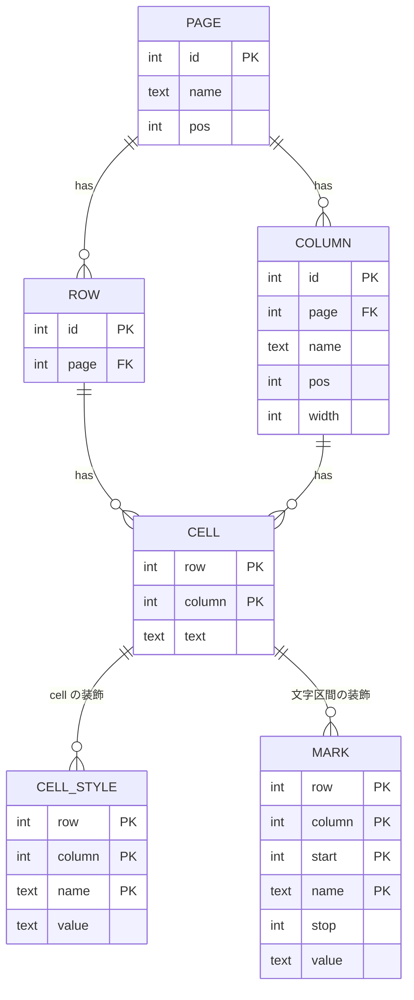

# table 設計

正規化し切った形から出発し、実際に投げる SQL が 1 文で書ける所まで崩した形を採る。崩す根拠は「触る page の数」である。触る page が file 上で散らばるほど GET する chunk が増え、書き換える page が増えるほど delta が大きくなる。PUT の回数は table 設計では変わらない。

## 1. 出発点 (正規形)



全ての非 key 属性が key 全体にだけ従属し、同じ事実は 1 か所にしか無い。列の追加も削除も行の操作 (DML) で済み、外部 key の cascade で装飾の後始末ができる。

## 2. 実際に投げる SQL

| 使い方            | 正規形                                  | 採用形                                                                  |
| ----------------- | --------------------------------------- | ----------------------------------------------------------------------- |
| 窓を読む          | CELL を行の範囲で絞り、列の数だけ pivot | `select * from "page" where "_id" >= ? order by "_id" limit ?`          |
| cell の確定       | CELL の upsert 1 行                     | `update "page" set "col" = ? where "_id" = ? and "col" is not ?`        |
| 行の追加          | ROW 1 行 (CELL は無くてよい)            | `insert into "page" default values returning "_id"`                     |
| 行の削除          | ROW の delete と cascade                | `delete from "page" …` と `_style` / `_mark` の delete を 1 transaction |
| 列の追加          | COLUMN 1 行                             | `alter table "page" add column "col" text`                              |
| 列名の変更        | COLUMN 1 行                             | `alter table … rename column …` と装飾の `col` の update                |
| 列の削除          | COLUMN の delete と cascade             | `alter table … drop column …` と装飾の delete を 1 transaction          |
| 取込              | ROW と CELL を行 × 列 件                | `insert into "page" (…) select value ->> 0, … from json_each(?)`        |
| 集計 (LLM の SQL) | pivot してから集計                      | `select "col", count(*) from "page" group by "col"`                     |
| 窓の装飾を読む    | STYLE / MARK を行の範囲で               | `… where "page" = ? and "row" in (窓の _id)`                            |
| 列の一覧と幅      | COLUMN を page で                       | `pragma_table_info(?)` に `_style` の `row = 0` を left join            |

正規形の難点は窓と集計に集まる。どちらも pivot が要り、SQL が列数に比例して長くなり、1 cell が 1 行になるので同じ窓が触る leaf が増える。正規形の利点である「列の操作が DML で済むこと」は、`ADD COLUMN` と `RENAME COLUMN` が schema の page だけを書くことで足りる。

## 3. 到達点 (採用形)

```mermaid
erDiagram
    PAGE_TABLE ||--o{ STYLE : "(page, row, col)"
    PAGE_TABLE ||--o{ MARK : "(page, row, col)"
    PAGE_TABLE { int _id PK  text 利用者の列 }
    STYLE { text page PK  int row PK  text col PK  text name PK  text value }
    MARK { text page PK  int row PK  text col PK  int start PK  text name PK  int stop  text value }
```

| 正規形の table | 採用形での居場所                                                                                   |
| -------------- | -------------------------------------------------------------------------------------------------- |
| PAGE           | SQLite の schema。page 名が table 名、並びは `sqlite_master` の rowid (作成順)                     |
| COLUMN         | SQLite の schema。列の存在と並びは `pragma_table_info` だけが正。幅は `_style` の `row = 0` の行   |
| ROW            | page table の行。`_id` (rowid、`AUTOINCREMENT`) が行の識別子で、縦の位置でもある                   |
| CELL           | page table の列の値。型は TEXT だけ                                                                |
| STYLE          | `_style`。`(page, row, col, name) → value`。cell に付き、本文が空になっても残る                    |
| MARK           | `_mark`。`(page, row, col, start, name) → (stop, value)`。本文の区間に付き、本文と同じ文で書き直す |

## 4. 崩し方ごとの根拠

**列を物理の列にする。** 窓と集計が 1 文になり、行の全 cell が同じ leaf に載る。引き換えに `DROP COLUMN` が table 全体の書き直しになる。

**列の台帳を持たない。** 列の存在を別 table にも書くと、同じ事実が 2 か所になる。幅だけを `_style` に置き、行が無ければ既定の幅とする。`_style` に行があっても列が在ることにはならない。

**装飾の key を名前にする。** `(page 名, _id, 列名)` は schema と行からそのまま読める。引き換えに列名の変更が装飾の update を伴う。

**装飾の名前の照合を識別子に合わせる。** SQLite は table 名と列名の ASCII の大文字小文字を区別しない。`update "p" set "a" = …` は列 `A` に当たる。装飾の `page` と `col` を既定の照合 (BINARY) のままにすると、本文は書けて装飾は別の key になり、列を消しても装飾が残る。`page` と `col` を `COLLATE NOCASE` にして、同じ規則で当たるようにする。

**外部 key を使わない。** page ごとに table が違うので参照先を書けない。行、列、page の削除は装飾の delete と同じ transaction に並べる。装飾の insert は `where exists (その行) and exists (その列)` を付けた `insert … select` にして、無い位置には書けないようにする。

**page table に index を作らない。** index は行の追加で書く page を増やし、`DROP COLUMN` を拒む。窓は rowid の範囲読みなので index は要らない。並べ替えと絞り込みは全走査になる。

**`_id` を縦の位置にする。** `count(*)` も `offset` も leaf を端から読む。`max("_id")` と `"_id" >= ?` は木の深さぶんの page で済む。行を消すと番号が欠けるので、窓は「`_id >= top` の先頭 n 行」で読む。

**`_id` を使い回さない。** `AUTOINCREMENT` を付けない rowid は、末尾の行を消すと同じ番号を次の行に振る。装飾も編集の履歴も `(page, _id, 列名)` を key にするので、番号が使い回されると消えた行宛ての undo が別の行に書かれる。`AUTOINCREMENT` は振った最大の番号を `sqlite_sequence` に残す。引き換えに行の追加が `sqlite_sequence` の leaf も書く。

## 5. 孤児の検査

装飾が指す位置が無い行を孤児と呼ぶ。0 件が常態である。

```sql
select count(*) from "_style" s where s."page" = ? and (
        (s."row" > 0 and s."row" not in (select "_id" from "<page>"))
        or s."col" not in (select "name" from pragma_table_info(?)))
```

page そのものが無い装飾は `s."page" not in (select "name" from "sqlite_master" where "type" = 'table')` で数える。`_mark` も同じ形である。

## 6. 採っていないもの

列の型 (数値、日付、選択肢)、選択肢の辞書、行の並べ替え位置、layout (section と item) は無い。足すときの置き場は、列の属性なら `_style` の `row = 0`、行に依らない設定なら新しい system table (`_` で始まる名前) である。
