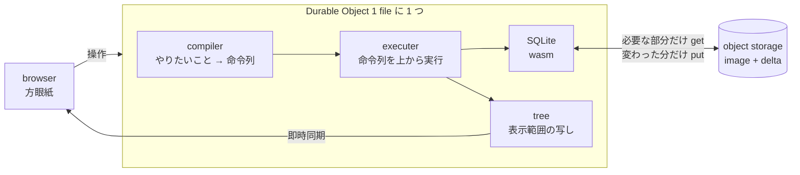

# 1 file = 1 SQLite database を object storage に置く方眼紙 editor

表計算の 1 file を 1 つの SQLite database として object storage に保存し、edge の小さな実行環境から読み書きする仕組みの PoC (概念実証)。browser の方眼紙から行・列・cell を操作でき、複数の browser に変更が即時に届く構成。

## 1. 要点

覚える言葉は 3 つ。**1 file 1 database** (表の中身を持つのは SQLite だけ)、**1 save 1 put** (保存 1 回につき object storage への書き込みは 1 回)、**compiler と executer** (やりたいことを装置への命令列に変える段と、命令列を実行する段の分離)。



## 2. Why — なぜ作るのか

### 2.1. 解く課題

表の行と列が増えると、画面同期用の data 構造を丸ごと保存・同期する方式は成り立たなくなる状況。保存のたびに全体を書き、開くたびに全体を読み、AI に渡す状態も全体になるため。必要なのは、全体を読まずに開け、変わった分だけを保存でき、SQL で必要な範囲だけを取り出せる保存形式。

制約は 2 つ。1 つ目は実行環境。Durable Object (1 つの名前につき 1 つだけ起動する小さな server。memory の上限 128 MB) の中で動かす前提。2 つ目は課金。object storage (R2) は byte ではなく操作の回数に課金する体系で、書き込み 1 回は読み込み 1 回の 12.5 倍の単価。

### 2.2. なぜ SQLite で、なぜ自作か

1 file を編集するのは 1 つの Durable Object だけで、同じ database に多数の writer が同時に書く状況が無い構造。単一 writer を前提とする SQLite の性質と一致。一方、SQLite の変更を object storage へ複製する既製の道具は、常駐する別 process と local disk を前提とし、Durable Object の中では動かないもの。そこで「SQLite が書いた page を受け取り、save が呼ばれたときだけ送る」最小の仕組みを、全体を読み切れる量 (server 側 約 750 行) で自作。

## 3. What — 何を作ったか

### 3.1. 言葉の定義

| 言葉            | 意味                                                                                           |
| --------------- | ---------------------------------------------------------------------------------------------- |
| page            | SQLite が file を区切る 4096 byte の固定長 block                                               |
| chunk           | 連続する 512 page (2 MiB)。圧縮と部分読み込みの単位                                            |
| image           | database の全 page を chunk ごとに gzip で圧縮して並べた object                                |
| delta           | 1 回の save で書き換わった page だけを集めた object                                            |
| 鎖              | delta が「1 つ前の object の版 (etag)」を持つことで決まる順序                                  |
| merge           | image と delta と未保存の page を 1 つの image に書き直す操作                                  |
| page 層         | SQLite に file として見せる層。取得済みの chunk、未保存の page、書き換わった page 番号を保持   |
| view (窓)       | server に登録した問い合わせと、その結果を同期用の tree に載せたもの。画面が読む唯一の data     |
| logical な命令  | 利用者や AI がしたいこと (cell の確定、行の追加、窓の移動、保存など)                           |
| physical な命令 | 装置 1 つへの操作 (SQL の実行、view の更新、delta の送信など)。cell や列名の意味を含まない命令 |

### 3.2. 3 つの柱

**保存の形。** object storage には image 1 つと、番号の付いた delta が並ぶ形。開くときは image の先頭 1 chunk だけを読み、残りは SQL が必要とした chunk だけを後から取得。保存は変わった page を delta 1 つにまとめて 1 回で送信。delta が溜まったら image に畳み、古い delta を削除。image が 1 chunk に収まる小さな file は delta を作らず、毎回 image ごと 1 回で書く方式。

**命令の 2 段。** 入力は logical な命令。compiler が検査し、physical な命令の配列に変換。compiler は何も実行しない純粋な関数で、出力は値として比較可能。executer は配列を上から実行するだけで、途中で失敗したら書きかけの transaction を取り消し。

**窓。** 行と装飾を持つのは SQLite だけ。同期用の tree には、各 browser が見ている範囲の問い合わせ結果だけを載せる構成。書き込みのたびに登録済みの問い合わせを実行し直し、変わった行だけを tree に反映。tree の大きさは表の行数に依存しない設計。

## 4. How — どう動くか

### 4.1. 要件

| 区分        | 要件                                                                                                         |
| ----------- | ------------------------------------------------------------------------------------------------------------ |
| 利用の要件  | 方眼紙で page・行・列を足し、cell を編集し、装飾を付け、CSV を取り込み、SQL で集計できること                 |
| 利用の要件  | 人の操作と AI の操作が同じ命令を通り、片方の変更がもう片方に即時に見えること                                 |
| data の要件 | 1 page = 1 table。cell は文字列のみ。装飾は cell の位置に付き、本文が空でも残り、行や列と同時に消えること    |
| data の要件 | 列の存在と並びの正は 1 か所 (SQLite の schema) だけ                                                          |
| 基盤の要件  | 保存は明示的に呼ばれたときだけ。1 回の保存は 1 回の put。変化が無ければ object storage を呼ばないこと        |
| 基盤の要件  | 開くときに全体を読まないこと。途中で落ちても、保存済みの内容が「前の保存」か「今の保存」のどちらかであること |
| 基盤の要件  | object storage との境界は interface 1 本 (get / put / delete)。別の S3 互換 storage へ差し替え可能な形       |

### 4.2. どこに何があるか

実行環境は 3 つで、`src/` 直下の 3 file がそれぞれの入口。

| file             | 環境           | 役割                                                                                   |
| ---------------- | -------------- | -------------------------------------------------------------------------------------- |
| `src/client.tsx` | browser        | 同期の接続、操作の送信 (HTTP POST)、方眼紙の描画                                       |
| `src/index.tsx`  | worker         | `/parties/*` の request を Durable Object へ振り分け                                   |
| `src/server.tsx` | Durable Object | database を開く、命令を受けて実行、save を呼ぶ間隔の決定、object storage (R2) との接続 |

本体は 2 つの package 群。どちらも「compiler / executer / share」に分かれ、その下が再帰的に `packages/{declarative|procedural}/{名前}` へ分かれる構造。declarative は状態を持つ部品と一覧表 (何があるか)、procedural は状態を持たない手続き (どう計算するか)。親は子を import でき、子は祖先の `share` だけを import 可能。兄弟同士の import は禁止で、各 `package.json` の `dependencies` に無い import は build 時に拒否。

```
src/server/db                      createDb(input) → { run, compile, execute, stat }
├─ packages/share                  定数と型
├─ packages/compiler               compile(op, stat) = plan(parse(op), stat)
│  ├─ declarative/parse            命令ごとの field と検査の表        └─ procedural/check   検査の関数
│  ├─ declarative/plan             命令ごとの命令列
│  │  ├─ declarative/sync          開く、保存 (delta か merge かの式)
│  │  ├─ declarative/table         page と列の追加・削除・改名
│  │  ├─ declarative/row           行、cell、装飾、取込
│  │  ├─ declarative/view          窓、SQL、undo
│  │  └─ procedural/share          system table の定義、SQL の組み立て
│  └─ procedural/share             undo 用の key と値の形
└─ packages/executer               physical な命令 14 種と装置の対応表
   ├─ declarative/sqlite           wasm の接続、文の実行、読み取り専用の実行
   ├─ declarative/page             page 層 (SQLite に見せる file)
   ├─ declarative/store            image と delta の読み書き         └─ procedural/codec   object の形と gzip
   └─ declarative/tree             view の登録と反映、undo

src/client/db                      createGrid(input) → { Grid, dispatch, compile }
├─ packages/share                  定数と型
├─ packages/compiler               compile(event, snap) = plan(parse(event, snap), snap)
│  ├─ declarative/parse            key・wheel・file を操作に読み替え  └─ procedural/csv     CSV の読み取り
│  └─ declarative/plan             操作ごとの命令列                   └─ procedural/name, cursor
└─ packages/executer               state (局所状態) と send (server へ) の実行
   ├─ declarative/state            局所状態と tree の読み出し
   ├─ declarative/wire             送信の直列化
   └─ declarative/dom              方眼紙の描画                       └─ procedural/event   drag と drop
```

### 4.3. 命令

logical な命令は `{ type, ...field }` の形。browser からも AI からも同じ形で届く前提。

| type                               | 意味                                                                   |
| ---------------------------------- | ---------------------------------------------------------------------- |
| `open` / `save`                    | object storage から開き直す / 変わった page を保存                     |
| `page.add` / `page.del`            | page (= table) の追加 / 削除                                           |
| `row.add` / `row.del`              | 行の追加 / 削除                                                        |
| `col.add` / `col.del` / `col.name` | 列の追加 / 削除 / 改名                                                 |
| `cell`                             | cell の本文と、文字区間の装飾 (太字など) の置き換え                    |
| `style`                            | cell の装飾 1 項目 (塗りなど)。行 0 は列見出しを指し、列幅もここに保存 |
| `window`                           | ある browser の表示範囲の変更                                          |
| `import`                           | 行の一括追加 (CSV の取込)                                              |
| `undo` / `redo`                    | 直前の `cell` / `style` を戻す / やり直す                              |
| `sql`                              | 読み取り専用の SQL。返す行は 100 まで                                  |
| `leave`                            | ある browser の表示範囲の登録を削除                                    |

physical な命令は `[code, ...operand]` の配列で 14 種。`pull` (object storage → page 層)、`open` (接続)、`sql`、`read` (読み取り専用)、`view` / `refresh` / `drop` (窓の登録・再計算・解除)、`fill` / `set` / `undo` / `redo` / `forget` (undo 用の記録)、`push` (delta の送信)、`merge` (image の書き直し)。

例として `cell` は次の列に変換。

```
fill   変更前の値を undo 用に記録 (まだ無ければ)
set    新しい値を、操作した人の履歴に記録
sql    begin
sql    update "page" set "列" = ? where "_id" = ? and "列" is not ?
sql    delete from "_mark" …   (その cell の文字区間の装飾)
sql    insert into "_mark" …   (新しい文字区間の装飾)
sql    commit
refresh  登録済みの窓を再計算し、変わった行だけ tree に反映
```

### 4.4. 保存と読み込み

```
image (番号 0)   [ "SQLI" | page 数 | chunk 数 | 各 chunk の圧縮後の長さ | gzip(chunk 0) | gzip(chunk 1) | … ]
delta (番号 1〜) gzip[ "SQLD" | 適用後の page 数 | 枚数 | 1 つ前の object の etag | (page 番号, page) × 枚数 ]
```

| 場面                | object storage への操作                                                      |
| ------------------- | ---------------------------------------------------------------------------- |
| 開く (小さい file)  | get 1 回 (image 全体が手に入る)                                              |
| 開く (2 chunk 以上) | image の先頭の get 1 回、delta の数だけ get、終端の確認の get 1 回           |
| SQL が page を読む  | memory に無い chunk 1 つにつき get 1 回                                      |
| 保存 (変化なし)     | 0 回                                                                         |
| 保存 (delta)        | put 1 回                                                                     |
| 保存 (merge)        | 2 chunk 以上なら古い image の get 1 回、put 1 回、delta があれば delete 1 回 |

壊れにくさの根拠は 3 点。put は object 単位で全部か無か、かつ毎回「前に読んだ版と同じなら」または「まだ無ければ」の条件付き。delta は 1 つ前の object の etag を持つため、image を書き直した後に消し損ねた古い delta は鎖から外れ、適用されない仕組み。命令列は 1 本の列に並んで順に走り、保存はその切れ目でしか走らない構造。

delta で送るか merge するかは費用の式で決定。delta を 1 つ持ち越すと以後の「開く」のたびに get が 1 回増え、merge には古い image の get 1 回と image 全体の転送が必要。持ち越した get の累計 `N(N+1)/2` が、merge の費用 `1 + 2 × page 数 ÷ 2048` に並んだ保存で merge。加えて、memory に抱える未保存分と delta 分の合計が 1 chunk に達したら merge。

保存を呼ぶ間隔も式で決定。put 1 回の単価は Durable Object の稼働 2.8 秒ぶん。put の費用を稼働費用の 5% に抑える間隔は 56 秒。アプリは「最後の編集から 28 秒、編集が続いても 56 秒」で保存を呼び、最後の接続が閉じたときにも呼ぶ設定。

### 4.5. table 設計

```mermaid
erDiagram
    PAGE_TABLE ||--o{ STYLE : "(page, row, col)"
    PAGE_TABLE ||--o{ MARK : "(page, row, col)"
    PAGE_TABLE { int _id PK  text 利用者の列 }
    STYLE { text page PK  int row PK  text col PK  text name PK  text value }
    MARK { text page PK  int row PK  text col PK  int start PK  text name PK  int stop  text value }
```

page は 1 つの table で、利用者の列がそのまま物理の列 (全て文字列)。列の存在と並びは SQLite の schema だけが正で、列の台帳を別に持たない設計。`_style` は cell に付く装飾 (塗り、列幅) を、`_mark` は本文の文字区間に付く装飾 (太字) を保持。行・列・page の削除と列の改名は、装飾の削除・付け替えと同じ transaction。装飾の追加は、その行とその列が在るときだけ行が入る文。行の識別子 `_id` は縦の位置を兼ね、窓は「`_id` が指定値以上の先頭 n 行」で読むため、表の行数に依らず数 page の読みで完了。

### 4.6. 画面と操作

方眼紙は 1 マス 24px の格子。1 page に table が 1 つ。列の幅は 1 〜 12 マスの整数で、行の高さは 1 マス。上部に「ページを追加・行を追加・列を追加・削除・太字・塗り・元に戻す・やり直す・保存・開き直す」の button と page の tab、下部に SQL の入力欄と結果の表。

| 操作                                    | 画面の動き                      | server に送る命令                 |
| --------------------------------------- | ------------------------------- | --------------------------------- |
| click、矢印 key、Tab                    | 選択枠の移動                    | 無し                              |
| Enter、F2、double click、文字 key       | 編集欄の表示                    | 無し                              |
| 編集中の Enter、Tab、他の cell の click | 確定して選択を移動              | `cell` (列名の行なら `col.name`)  |
| Escape                                  | 編集の破棄                      | 無し                              |
| Delete                                  | 本文を空に                      | `cell`                            |
| wheel、窓の端での矢印 key               | 表示範囲の移動                  | `window`                          |
| 列名の右端の drag                       | drag 中は線だけ、離すと幅が確定 | `style` (列幅)                    |
| CSV file の drop                        | 新しい page として取込          | `import` を 2000 行ずつ、`window` |
| Ctrl / ⌘ + Z、Y                         | 直前の編集を戻す、やり直す      | `undo` / `redo`                   |

選択、編集中の文字列、表示中の page と位置は browser の中だけの状態。browser は同期用の tree を読むだけで、書き込まない方針。

### 4.7. undo

SQLite 自体には戻す仕組みを持たせない方針。`cell` と `style` は、書く前の値を cell の位置を key にして記録してから新しい値を書き、同期 library の履歴機能がその記録を 1 つ戻す流れ。戻った位置と値を logical な命令に読み替え、通常と同じ compiler の経路で SQL に反映。履歴は操作した人ごとで、窓の移動は履歴の対象外。行・列・page の削除と列の改名は全員の履歴を破棄。

### 4.8. 技術の選定

| 技術                    | 役割                               | 選んだ理由                                                                  |
| ----------------------- | ---------------------------------- | --------------------------------------------------------------------------- |
| wa-sqlite (Asyncify 版) | wasm の SQLite                     | file の読み書きを JavaScript で差し替え可能。読み込みの途中で通信を待てる版 |
| drizzle-orm             | SQL の組み立て                     | 値を必ず bind し、名前を識別子として囲む仕組み                              |
| yjs / y-partyserver     | browser と server の即時同期、履歴 | 表示範囲の写しと undo の記録に使用                                          |
| partyserver / Hono      | Durable Object への経路            | 部屋名 = file 名で 1 つの Durable Object に到達                             |
| `CompressionStream`     | gzip                               | browser・worker・node に標準で在る機能。自前の圧縮 code が不要              |
| React / Tailwind CSS    | 方眼紙の描画                       | 描画だけを担当し、状態は外部の store から受け取る構成                       |

### 4.9. 起動

依存の導入後、`pnpm dev` で開発 server が起動。browser で `/?room=<名前>` を開くと、その名前の file (無ければ `ページ 1` を持つ新しい database) を編集。設定は `wrangler.jsonc` にあり、Durable Object の binding 名は `v1`、R2 の binding 名は `r2`。

### 4.10. 検証

検証は決定論的 simulation で行う方針。seed 1 つから操作列・障害・作り直しの時点を生成し、同じ seed が同じ結果を再現。障害は object storage の境界 (get / put / delete の失敗、put の条件不一致、途中での作り直し) にだけ注入。期待値は製品とは別に持ち、永続・原子・回数・鎖・単一書き・上限・compile・装飾・窓・履歴の 10 軸で判定。生成 code は `test/`、入口は `.bench/run.mjs`、結果の台帳は `.bench/out/`。境界・軸・台帳の定義は `.claude/skills/sqlite/references/score.md`、検証 code が触れてよい面は `contract.md`。

### 4.11. 範囲外と制約

| 項目                         | 内容                                                             |
| ---------------------------- | ---------------------------------------------------------------- |
| database の大きさ            | 上限 8192 page (32 MiB)。超える書き込みは拒否                    |
| 過去の版への復元             | 無し。merge 済みの delta は削除                                  |
| 列の型、選択肢、行の並べ替え | 無し。cell は文字列のみ                                          |
| table の外のマス             | 値も装飾も持たない仕様                                           |
| 公開用の配信                 | 無し                                                             |
| 保存していない編集           | Durable Object が落ちると消失。最大で保存の間隔 (56 秒) ぶん     |
| put が書いた後に失敗した場合 | その起動中の保存は停止。開き直すと object storage の内容から再開 |
| 履歴                         | Durable Object の生存期間に限定                                  |

### 4.12. 現状 (2026-11-10)

server 側・client 側・アプリ 3 file・規約文書は実装済み。実装者は node を実行できない制約の下で書いており、開発 server と workerd の上での起動は未確認。検証 code は作成と実行の途中で、台帳は未作成。転送速度と圧縮比は未計測で、merge の式の定数 (2048) は仮の値。

### 4.13. 文書の所在

| 知りたいこと                          | file                                           |
| ------------------------------------- | ---------------------------------------------- |
| 守るべき性質と、壊れ方から見る場所    | `.claude/skills/sqlite/SKILL.md`               |
| 公開している面、object の形、命令の表 | `.claude/skills/sqlite/references/contract.md` |
| 費用の式と定数の根拠                  | `.claude/skills/sqlite/references/cost.md`     |
| table の正規形と崩し方                | `.claude/skills/sqlite/references/tables.md`   |
| 方眼紙、窓、装飾、undo                | `.claude/skills/sqlite/references/grid.md`     |
| 外部の事実と確かめ方                  | `.claude/skills/sqlite/references/errata.md`   |
| 検証の境界、軸、台帳                  | `.claude/skills/sqlite/references/score.md`    |
